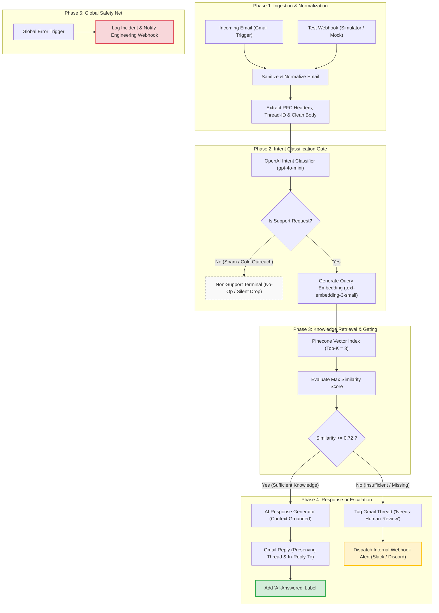
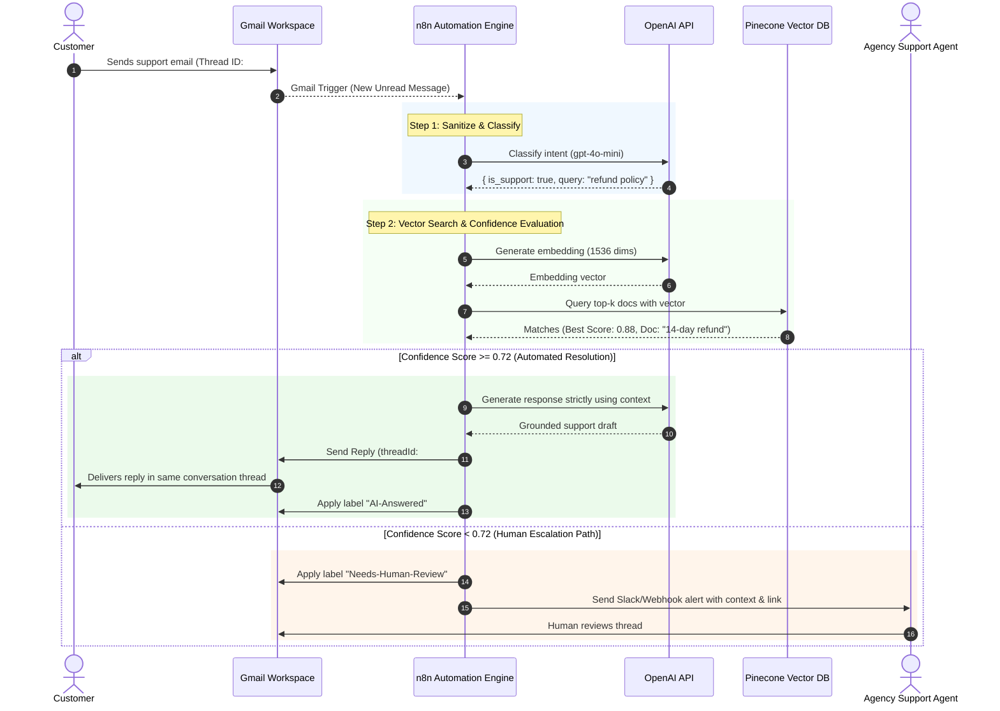
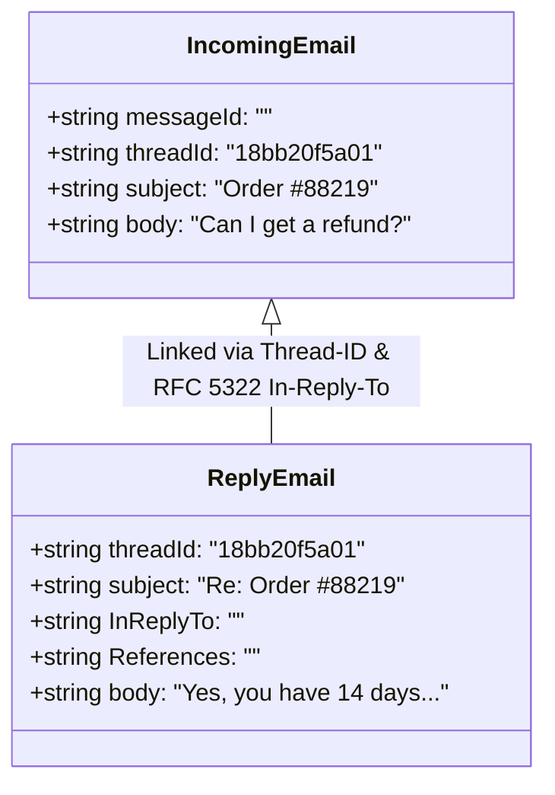

# Deliverable 2: Process Flow Diagram

**Project:** AI Customer Support Email Workflow (n8n, Pinecone, OpenAI, Gmail)  
**Version:** 1.0.0  
**Date:** 2026-10-26  

---

## 1. High-Level Automation Architecture

The following flowchart illustrates the complete lifecycle of an incoming email through ingestion, classification, vector retrieval, confidence-gating, response generation, and escalation.

---

## 2. Sequence Diagram (Multi-Party Interaction)

This sequence diagram depicts the chronological message exchange between the Customer, Gmail Service, n8n Orchestrator, OpenAI, Pinecone Vector DB, and Agency Human Staff.

---

## 3. RFC Thread Continuity Architecture

To guarantee that email replies stay grouped together inside the recipient's email software (Gmail, Outlook, Apple Mail), the workflow enforces the following header mappings:

